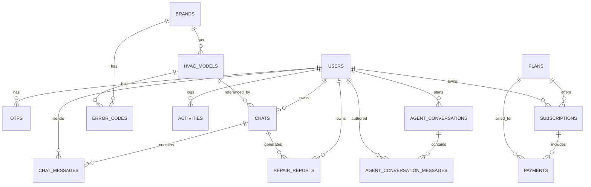

# Software Requirements Specification (SRS)

Project: maboydem
Version: 1.0
Date: 2026-05-25

## 1. Introduction

### 1.1 Purpose

This document defines the software requirements with a primary focus on the database design as implemented by the current migrations.

### 1.2 Scope

The application provides user accounts, role-based access control, HVAC knowledge base, chat and repair reports, subscription billing, static content management, activity tracking, AI agent conversations, and vector search. This SRS captures the data model that supports these capabilities.

### 1.3 Definitions and Acronyms

- RBAC: Role-Based Access Control
- OTP: One-Time Password
- FK: Foreign Key
- UUID: Universally Unique Identifier

## 2. Overall Description

### 2.1 Product Perspective

The system is a Laravel-based web application using a primary relational database for core data and a separate PostgreSQL database for vector embeddings.

### 2.2 User Classes and Characteristics

- Authenticated users: Standard application users who own chats, reports, subscriptions, and activities.
- Administrators and staff: Users granted access via roles and permissions.

## 3. System Features (High Level)

- User identity, sessions, OTP verification, and personal access tokens.
- AI agent conversations and message history.
- HVAC domain data (brands, models, error codes).
- Chat threads, chat messages, and generated repair reports.
- Subscription plans, subscriptions, and payments.
- Static pages and system settings.
- Activity tracking.
- Vector embeddings for manual content.

## 4. Database Design

### 4.1 Database Connections

- Primary relational database: default connection (MySQL for several domain tables).
- Vector database: `pgsql_vector` connection with the `vector` extension enabled.

### 4.2 Logical ERD (Core Domain)

### 4.3 Table Dictionary

#### Core Identity and Access

- users
    - id (PK), email (unique, required), username (unique, nullable), password (nullable)
    - two_factor_secret, two_factor_recovery_codes, two_factor_confirmed_at (nullable)
    - profile fields: first_name, last_name, avatar, cover_photo (nullable)
    - contact fields: phone, whatsapp_number, country_code, country_name, state, city, zip_code, address, website (nullable)
    - email_verified_at (nullable), fcm_token (nullable)
    - terms_and_conditions (boolean, default false), status (enum: active, inactive; default active)
    - remember_token, created_at, updated_at, deleted_at (soft deletes)
- password_reset_tokens
    - email (PK), token, created_at
- sessions
    - id (PK), user_id (indexed, nullable), ip_address, user_agent, payload, last_activity (indexed)
- personal_access_tokens
    - id (PK), tokenable_type, tokenable_id, name, token (unique), abilities, last_used_at, expires_at (indexed), created_at, updated_at
- otps
    - id (PK), user_id (FK users.id), type, token (unique), otp, expires_at, used (boolean default false), created_at, updated_at

#### RBAC (Spatie Permission)

- permissions
    - id (PK), name, guard_name, created_at, updated_at (unique on name + guard_name)
- roles
    - id (PK), name, guard_name, created_at, updated_at (unique on name + guard_name; optional team key)
- model_has_permissions
    - permission_id (FK), model_type, model_id (morph), optional team key
- model_has_roles
    - role_id (FK), model_type, model_id (morph), optional team key
- role_has_permissions
    - permission_id (FK), role_id (FK)

#### AI Agent Conversations

- agent_conversations
    - id (UUID PK), user_id (nullable), title, created_at, updated_at (index on user_id + updated_at)
- agent_conversation_messages
    - id (UUID PK), conversation_id, user_id (nullable)
    - agent, role, content, attachments, tool_calls, tool_results, usage, meta
    - created_at, updated_at (index on conversation_id + user_id + updated_at)

#### HVAC Knowledge Base

- brands
    - id (PK), name (unique), logo_path, created_at, updated_at
- hvac_models
    - id (PK), brand_id (FK brands.id), name, model_number, capacity_btu, efficiency_rating
    - power_spec, refrigerant_type, image_path, created_at, updated_at
- error_codes
    - id (PK), brand_id (FK brands.id, nullable), hvac_model_id (FK hvac_models.id, nullable)
    - code (indexed), description, resolution_steps, created_at, updated_at

#### Chat and Reports

- chats
    - id (PK), user_id (FK users.id), hvac_model_id (FK hvac_models.id, nullable)
    - title, status (default active), created_at, updated_at
- chat_messages
    - id (PK), chat_id (FK chats.id), sender_id (FK users.id, nullable)
    - sender_role, content, attachments (json), created_at, updated_at
- repair_reports
    - id (PK), user_id (FK users.id), chat_id (FK chats.id, nullable)
    - title, location, status (default completed), pdf_path, created_at, updated_at

#### Billing

- plans
    - id (PK), name, price, original_price (nullable), currency (default USD)
    - apple_product_id, google_product_id, stripe_product_id (nullable)
    - features (json, nullable), billing_interval (enum: daily, weekly, monthly, yearly)
    - trial_days (default 0), is_recommended (default false), status (enum: active, inactive; default active)
    - created_at, updated_at
- subscriptions
    - id (PK), user_id, plan_id (FK plans.id)
    - status (enum: active, canceled, past_due, trialing, paused)
    - starts_at, ends_at, cancelled_at (nullable)
    - amount_paid, payment_method, transaction_id (unique)
    - provider_metadata (json, nullable), created_at, updated_at
- payments
    - id (PK), user_id, subscription_id (FK subscriptions.id, nullable), plan_id (FK plans.id)
    - amount, currency (default USD), payment_method, transaction_id (unique)
    - status (enum: pending, completed, failed, refunded)
    - metadata (json, nullable), created_at, updated_at

#### Settings and CMS

- system_settings
    - id (PK), system_name (default Laravel), logo, favicon, created_at, updated_at
- static_pages
    - id (PK), type, title, slug (unique), status (default draft)
    - content (json, nullable), created_at, updated_at
- activities
    - id (PK), user_id (FK users.id), activity_type, title, description, details (json, nullable)
    - created_at, updated_at (index on user_id + activity_type + created_at)

#### Infrastructure

- cache: key (PK), value, expiration (indexed)
- cache_locks: key (PK), owner, expiration (indexed)
- jobs: id (PK), queue, payload, attempts, reserved_at, available_at, created_at (index on queue + reserved_at + available_at)
- job_batches: id (PK), name, total_jobs, pending_jobs, failed_jobs, failed_job_ids, options, cancelled_at, created_at, finished_at
- failed_jobs: id (PK), uuid (unique), connection, queue, payload, exception, failed_at

#### Vector Search (Separate Database)

- manual_vectors (connection: pgsql_vector)
    - id (bigserial PK), content (text), embedding (vector(1536))

### 4.4 Keys, Constraints, and Indexes

- Unique constraints: users.email, users.username, brands.name, error_codes.code (indexed), static_pages.slug,
  personal_access_tokens.token, otps.token, roles.name + guard_name, permissions.name + guard_name,
  subscriptions.transaction_id, payments.transaction_id.
- Indexes: error_codes.code, error_codes.hvac_model_id, sessions.user_id, sessions.last_activity,
  activities.user_id + activity_type + created_at, subscriptions.user_id + status, payments.transaction_id,
  agent_conversations.user_id + updated_at, agent_conversation_messages.conversation_id + user_id + updated_at.

### 4.5 Referential Integrity and Delete Behavior

- Cascade deletes: brands -> hvac_models, brands -> error_codes, hvac_models -> error_codes,
  users -> otps, users -> chats, users -> repair_reports, users -> activities,
  chats -> chat_messages, plans -> subscriptions, plans -> payments.
- Set null on delete: chats.hvac_model_id, chat_messages.sender_id, repair_reports.chat_id, payments.subscription_id.
- Logical (application-level) references without enforced FK constraints: subscriptions.user_id, payments.user_id,
  agent_conversations.user_id, agent_conversation_messages.user_id.

### 4.6 Notes

- The vector database is isolated from the main relational database and requires the `vector` extension.
- The `payments` table is defined by migrations with identical schema; the logical model contains a single `payments` table.
